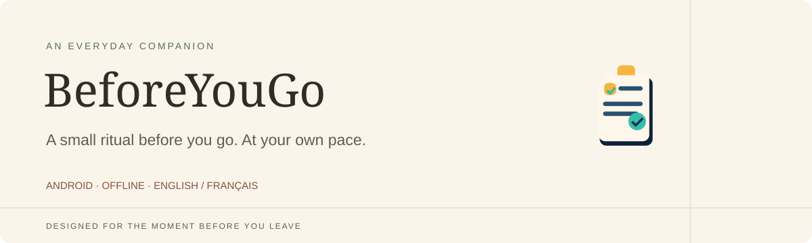

  

  <strong>An offline Android companion for a calmer departure.</strong> 
  English by default · French available in the app · Android 8.0+

  <a href="#the-experience">The experience</a> ·
  <a href="#availability">Availability</a> ·
  <a href="#privacy">Privacy</a> ·
  <a href="docs/DEVELOPMENT.md">Development</a> ·
  <a href="README.fr.md">Français</a>

## The experience

Keys, a water bottle, the little things that make a day yours. BeforeYouGo helps you gather what you want to take with you, through an illustrated bag and a simple, personal routine.

- **Prepare your bag.** Choose your everyday essentials or add your own objects.
- **Make departures your own.** Set a time and choose a quiet invitation or an optional ringtone.
- **Stay in control.** Pack and unpack freely, and leave whenever you are ready.
- **Choose your language.** Switch between English and French in **My preferences → Language**. Your personal entries keep their original wording.

Warm paper tones, illustrated objects and light or dark appearance give the app the feel of a personal notebook. No scores, streaks or pressure to complete a perfect routine.

## Availability

**BeforeYouGo is in development for a future Google Play release.** It is not yet available on the Play Store; no release date is announced.

Local builds and automated checks pass. Physical-device validation, production signing, the published privacy policy and store review are still part of release preparation. This repository presents the project; it is not a production download channel.

Public previews are intentionally limited while the release is being prepared.

## Privacy

The current app works offline, without accounts, advertising or analytics. It requests no Internet permission. Your objects, departures and preferences stay on your device; app data is excluded from Android cloud backup and device-transfer backup.

Scheduled reminders use Android permissions and depend on your device settings. Clearing app data or uninstalling removes your saved entries.

This summary describes the current implementation. The final Google Play release will include its own published privacy policy.

## Development

Built with **Kotlin, Jetpack Compose and Material 3**. English and French resources are packaged together for offline language switching.

See the [development guide](docs/DEVELOPMENT.md) for build requirements and verification commands.

Production signing keys, credentials, personal configuration, internal specifications and unreleased recordings belong outside the published repository. Local exclusion rules help prevent accidental commits; they do not hide files already committed in Git history.

## Feedback

Found a problem? [Open an issue](https://github.com/toaandri/BeforeYouGo/issues) with your Android version, device model and steps to reproduce it. Keep personal information, credentials and signing material out of public reports.

## License

No source-code reuse license is currently provided. Included third-party components retain their respective licenses.
